# ChainOps: Multi-Agent Supply Chain Control Tower


ChainOps reacts to supply chain events (a stock drop, a late shipment, a demand spike). It checks the data, runs five LangGraph agents to recommend a replenishment action, and holds any risky order until a named person approves it. Every decision is stored with the evidence behind it, and the whole workflow is tested against 18 scenarios.

What changed from the original project and how each part was verified: [docs/SUMMARY.md](docs/SUMMARY.md).

It is a portfolio prototype. Orders are **simulated**: an approved order becomes a row in a local SQLite table. No ERP or supplier system is contacted.

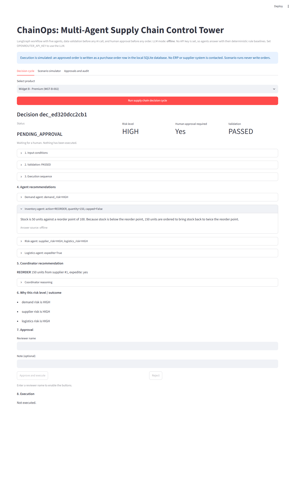

---

## Contents

1. [Problem](#1-problem)
2. [Key capabilities](#2-key-capabilities)
3. [Architecture](#3-architecture)
4. [Agents and workflow](#4-agents-and-workflow)
5. [Event-driven execution](#5-event-driven-execution)
6. [Data validation](#6-data-validation)
7. [Human approval lifecycle](#7-human-approval-lifecycle)
8. [Decision and audit records](#8-decision-and-audit-records)
9. [API](#9-api)
10. [Scenario simulator (UI)](#10-scenario-simulator-ui)
11. [Evaluation methodology and results](#11-evaluation-methodology-and-results)
12. [Installation and configuration](#12-installation-and-configuration)
13. [Running it](#13-running-it)
14. [Tests](#14-tests)
15. [What is simulated and what is real](#15-what-is-simulated-and-what-is-real)
16. [Known limitations](#16-known-limitations)
17. [Future improvements](#17-future-improvements)
18. [Project structure](#18-project-structure)
19. [Author](#author)

---

## 1. Problem

A replenishment planner watches stock, supplier reliability, shipments and demand, and decides whether to reorder, how much, from whom, and whether to pay for faster shipping. An LLM agent can help reason over these signals, but three things stop you from letting it place orders on its own:

* **Bad data in, bad orders out.** A warehouse feed that reports -15 units should stop the process, not produce a confident recommendation.
* **LLM output is not reliable enough to act on directly.** It can be malformed, it can contradict the stated rules, or the API can be down.
* **Someone has to be accountable.** High-risk spend needs a named approver, and you need to reconstruct later why an order was placed.

ChainOps is built around those three constraints.

## 2. Key capabilities

| Capability | How it is done | Where |
|---|---|---|
| Multi-agent orchestration | LangGraph `StateGraph`: ingestion, validation, 5 agents, decision gate, approval routing | `src/graph.py` |
| Event-triggered workflows | Pydantic event schemas, trigger thresholds, idempotent `event_id` | `src/events.py`, `src/workflow.py` |
| API integration | FastAPI: events, decision cycles, decision lookup, approve / reject / retry | `src/api.py` |
| Validation before AI | Business rules on the data; failures stop the graph before any agent runs | `src/validation.py`, `src/nodes/data_validation.py` |
| AI-output validation | Strict parsers + Pydantic models; every LLM answer is cross-checked against a deterministic rule baseline | `src/agents/outputs.py`, `src/agents/rules.py` |
| Human-in-the-loop governance | Explicit approval policy; compare-and-set state machine; recommendation and execution are separate states | `src/nodes/decision_gate.py`, `src/governance.py` |
| Traceable decisions | One audit record per decision: input, validation report, agent trace with timings, outputs, risk reasons, review, execution, errors | `src/models.py` (`DecisionRecord`) |
| Systematic evaluation | 18 scenarios with deterministic assertions, fault injection, metrics report | `evals/` |
| Runs without an API key | `offline` mode answers with the rule baselines, clearly labelled | `src/llm_config.py` |

## 3. Architecture

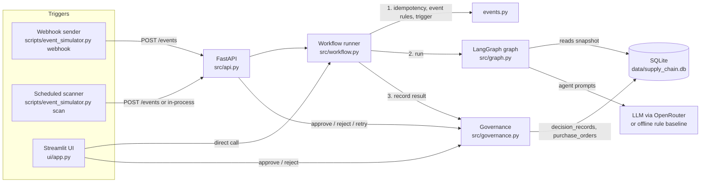

Design rule: **the graph has no side effects.** It reads the database and produces a recommendation plus a routing outcome. Only `governance.py` changes a decision's status or writes a purchase order, and only from an approved state.

## 4. Agents and workflow

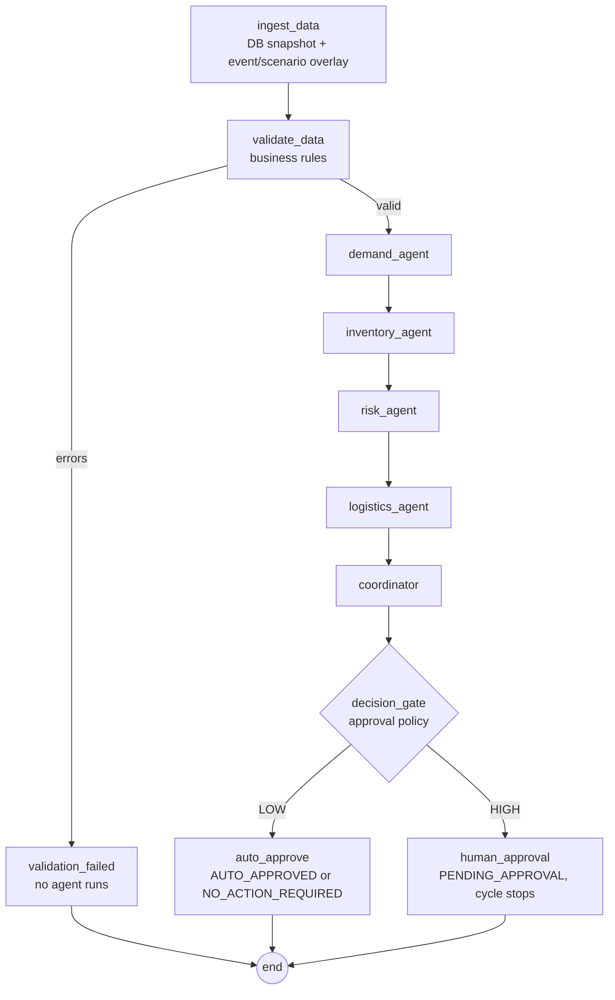

Agents run in sequence because each one reads the previous agents' outputs from the shared state.

| Agent | Decides | How the decision is made |
|---|---|---|
| Demand | demand risk LOW/HIGH | LLM classifies using the rules in its prompt; cross-checked by `demand_rule` |
| Inventory | REORDER/HOLD and quantity | **Deterministic code** (stock < reorder point, top up to 2x reorder point, capped at `MAX_ORDER_QUANTITY`). The LLM only writes the explanation. |
| Risk | supplier risk, logistics risk | LLM classifies; cross-checked by `risk_rule` (reliability < 90%, shipment > 7 days, overdue, none) |
| Logistics | expedite yes/no | LLM decides using three criteria; cross-checked by `logistics_rule` |
| Coordinator | final action, supplier, quantity, expedite | LLM synthesizes; decision type, quantity and expedite must match the inventory and logistics agents; supplier is the LLM's choice if it exists |

### How LLM answers are trusted (or not)

Every agent's prompt already stated explicit rules. `src/agents/rules.py` encodes the same rules in code, and `outputs.resolve()` reconciles the two:

* **Malformed output or LLM failure** (missing field, value outside the allowed set, two conflicting values, timeout): the rule answer is used and the output is flagged `output_valid: false`.
* **Risk levels:** the LLM may escalate (LOW to HIGH) but never downgrade.
* **Actions and flags:** the deterministic rule wins.
* **Any disagreement** is recorded and forces human approval.

So the LLM can make a decision more cautious and explain it, but cannot on its own make an unsafe order go through.

## 5. Event-driven execution

| Event type | Payload | Triggers a cycle when | Effect on the snapshot |
|---|---|---|---|
| `INVENTORY_LEVEL_CHANGED` | `observed_quantity` | observed stock < reorder point | stock replaced with the observed value |
| `SHIPMENT_DELAYED` | `delay_days`, optional `shipment_id` | `delay_days >= SHIPMENT_DELAY_THRESHOLD_DAYS` (2) | ETA pushed back |
| `DEMAND_SPIKE` | `demand_multiplier` | multiplier >= `DEMAND_SPIKE_THRESHOLD` (1.25) | reorder point scaled (see note) |

Pipeline for `POST /events`:

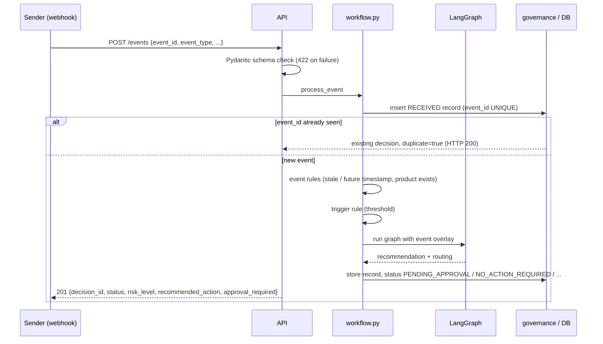

Events never modify the database. An event is turned into an **overlay**, applied to an in-memory copy of the snapshot, so it goes through exactly the same validation, agents and governance as any other cycle.

**Demand modelling note.** The data model has no demand history, only a reorder point. Since a reorder point is roughly lead-time demand plus safety stock, a demand change of factor *m* is modelled as an effective reorder point of `ceil(reorder_point * m)`. This is a stated assumption, not a forecast.

**Automated triggering demo** (`scripts/event_simulator.py`):

* `webhook` plays the external systems and posts nine events: a trigger, a replay of the same `event_id`, below-threshold events, a schema violation, a stale event and a cross-product reference.
* `scan` is a scheduled monitor: every `--interval` seconds it raises `INVENTORY_LEVEL_CHANGED` for products below their reorder point. Its `event_id` contains product, quantity and hour, so repeated scans of an unchanged situation are recognised as duplicates.

Processing is **synchronous**: the cycle runs inside the request, and the response carries its final status. There is no background queue.

Actual output of `python scripts/event_simulator.py webhook` against a fresh database (offline mode):

```text
API health: {"status": "ok", "llm_mode": "offline", "products": 3}

[201] Stock for Widget A drops to 40: dec_a58019f8230f status=PENDING_APPROVAL risk=HIGH action=REORDER 160
      trigger: observed stock 40 is below reorder point 100
[200] Same webhook delivered again: dec_a58019f8230f status=PENDING_APPROVAL risk=HIGH action=REORDER 160 (duplicate)
[201] Stock report above reorder point: dec_d8c72828e0ce status=NOT_TRIGGERED risk=None action=None
      trigger: observed stock 180 is at or above reorder point 100
[201] Carrier: Widget C shipment 5 days late: dec_a51c4ada6527 status=PENDING_APPROVAL risk=HIGH action=REORDER 140
      trigger: delay of 5 days meets the 2-day threshold
[201] Sales: demand +10% (under threshold): dec_7fdbe254128b status=NOT_TRIGGERED risk=None action=None
      trigger: demand x1.1 is under the x1.25 threshold
[201] Sales: demand x3 for Widget A: dec_740361a2a3e3 status=PENDING_APPROVAL risk=HIGH action=REORDER 350
      trigger: demand x3.0 meets the x1.25 threshold
[422] Negative stock in payload: rejected by schema: body.INVENTORY_LEVEL_CHANGED.observed_quantity: Input should be greater than or equal to 0
[201] Event from two days ago: dec_50e33d824937 status=VALIDATION_FAILED risk=None action=None
[201] Shipment that belongs to another product: dec_ea3062192efc status=VALIDATION_FAILED risk=None action=None
      trigger: delay of 4 days meets the 2-day threshold
```

The replayed webhook returns the same `decision_id` with HTTP 200, so a retrying sender never creates a second decision. The scheduled scanner behaves the same way: a second `scan --once` within the same hour reports every product as `(duplicate, already handled)`.

## 6. Data validation

Three separate layers, because they catch different problems:

| Layer | Question | Mechanism | On failure |
|---|---|---|---|
| 1. Schema | Is the payload well-formed? | Pydantic models with `extra="forbid"`, ranges, discriminated union on `event_type` | HTTP 422, nothing recorded |
| 2. Business rules | Is the data believable? | `validation.validate_snapshot`, `events.check_event_rules` | `VALIDATION_FAILED` record, **no agent runs** |
| 3. AI output | Is the LLM answer usable and consistent? | `agents/outputs.py` parsers, Pydantic models, rule cross-check | rule fallback, flagged, forces approval |

Business rules (thresholds in `src/config.py`, overridable in `.env`):

| Errors (block the cycle) | Warnings (cycle runs, approval forced) |
|---|---|
| negative stock; non-integer or missing quantity | PO open longer than `STALE_PO_DAYS` with no shipment |
| reorder point missing or <= 0 | in-transit shipment with no expected arrival date |
| missing inventory record; duplicate inventory rows | |
| no suppliers; reliability outside 0..1; lead time <= 0 | |
| PO with unknown supplier or quantity <= 0 | |
| shipment pointing at a PO that is not open for this product | |
| unknown supplier / shipment referenced by an event or scenario | |
| unparseable timestamps; event older than 24 h or in the future | |
| event for a product that does not exist | |

Operational risks such as a late shipment or an unreliable supplier are **not** validation failures. The data is fine; the situation is bad. Those are for the agents.

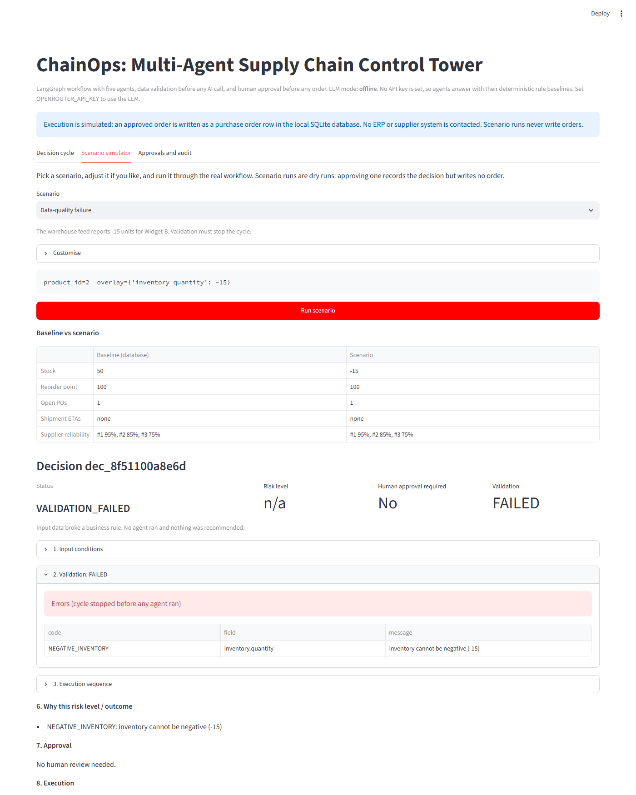

## 7. Human approval lifecycle

**Approval policy** (`src/nodes/decision_gate.py`). A REORDER needs a human if any of these is true:

1. demand, supplier or logistics risk is HIGH
2. any of those signals is missing or UNKNOWN
3. an agent's LLM output failed validation (rule fallback used)
4. an LLM answer disagreed with the deterministic rule
5. the quantity exceeds `APPROVAL_QUANTITY_THRESHOLD` (300)
6. the quantity was capped at `MAX_ORDER_QUANTITY` (1000)
7. the data passed validation only with warnings
8. the coordinator LLM chose a supplier other than the most reliable one (found in live runs; allowed by its prompt, but a human should see it)

A HOLD places no order, so it never needs approval (the original project's rule). The reasons are still recorded.

**State machine** (`src/governance.py`):

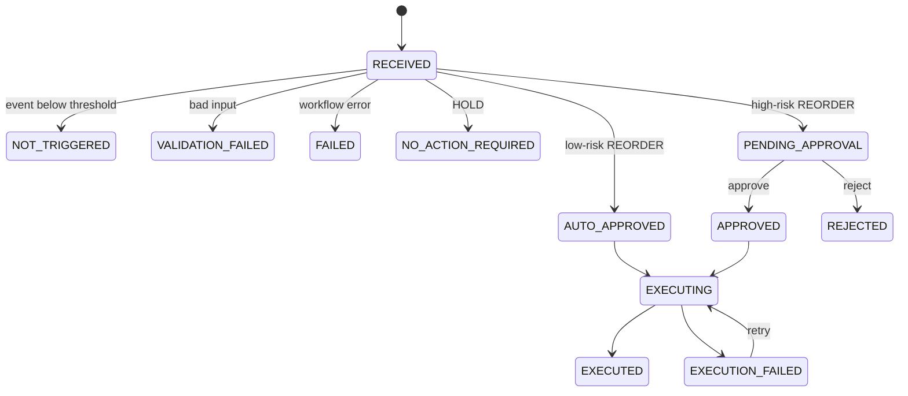

Guarantees, each covered by a test:

* A recommendation is never executed because it was generated; execution only starts from `APPROVED` or `AUTO_APPROVED`.
* Every transition is a compare-and-set `UPDATE ... WHERE status IN (...)`. Five threads approving the same decision at once produce exactly one execution and one PO (`test_concurrent_approvals_execute_once`).
* A repeated approve, an approve after reject, or approving a HOLD returns **409** with the current status.
* The PO insert and the `EXECUTED` status are one transaction. If it fails, nothing is written, the record becomes `EXECUTION_FAILED` with the error, and `retry-execution` is safe.
* Reviewer name, note and timestamps are stored on the record.

After approval, the record shows the full chain: agents that ran with their timings, each agent's output, why approval was required, who approved it and when, and the simulated execution result.

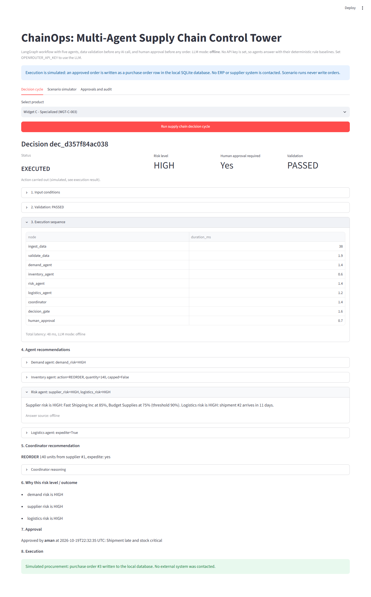

## 8. Decision and audit records

Table `decision_records`, one row per decision:

| Field group | Fields |
|---|---|
| Identity and input | `decision_id`, `trigger` (MANUAL / EVENT / SCENARIO), `event_type`, `event_id`, `product_id`, `input_payload`, `dry_run` |
| What the system saw | `snapshot` (data the agents actually used, after overlay), `validation_status`, `validation_report` |
| What it concluded | `agent_trace` (ordered nodes with ms timings), `agent_outputs` (each with `meta`: answer source, validity, issues, disagreements, rule baseline), `final_decision`, `risk_level`, `risk_reasons`, `approval_required`, `llm_mode` |
| What happened | `status`, `reviewed_by`, `review_note`, `reviewed_at`, `execution_result`, `executed_at`, `error` |
| Timing | `latency_ms`, `created_at`, `updated_at` |

The record shows **recorded evidence**: the inputs, each agent's output and the policy rules that fired. It does not generate an after-the-fact explanation. No API keys or credentials are stored, and errors keep only the exception type and a short message.

Structured JSON logs (`src/logging_config.py`) record cycle completion and every status transition with the decision id.

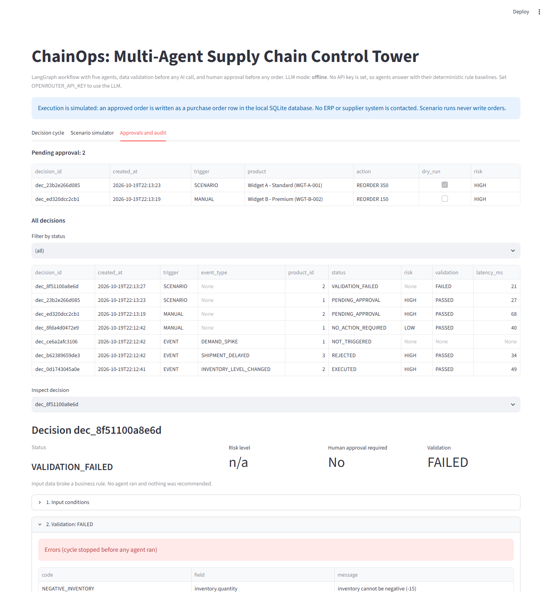

## 9. API

Interactive docs at `http://localhost:8000/docs`.

| Method | Path | Purpose | Notable responses |
|---|---|---|---|
| GET | `/health` | liveness, LLM mode, product count | 200 |
| GET | `/products` | product list | 200 |
| POST | `/events` | receive a business event | 201 new, **200 duplicate**, 422 schema |
| POST | `/decision-cycles` | run a cycle on demand; with `overlay` it is a dry-run scenario | 201, 404 unknown product |
| GET | `/decisions?status=&limit=` | list decision summaries | 200 |
| GET | `/decisions/{id}` | full audit record | 200, 404 |
| POST | `/decisions/{id}/approve` | approve and execute | 200, **409** invalid transition |
| POST | `/decisions/{id}/reject` | reject | 200, 409 |
| POST | `/decisions/{id}/retry-execution` | retry a failed execution | 200, 409 |

Cross-cutting: bodies over `MAX_REQUEST_BYTES` (16 KB) get **413**; missing LLM config in `live` mode gets **503** with an actionable message; unexpected errors get a generic **500** `{"error": "internal_error", "error_id": ...}` with no stack trace.

**Example: an event that triggers a cycle**

```bash
curl -X POST http://localhost:8000/events -H "content-type: application/json" -d "{\"event_id\": \"wms-1001\", \"event_type\": \"INVENTORY_LEVEL_CHANGED\", \"product_id\": 2, \"observed_quantity\": 30, \"occurred_at\": \"2026-10-20T09:00:00Z\", \"source\": \"wms-webhook\"}"
```

```json
{
  "decision_id": "dec_3f9a1c2b7e4d",
  "status": "PENDING_APPROVAL",
  "trigger": "EVENT",
  "event_type": "INVENTORY_LEVEL_CHANGED",
  "product_id": 2,
  "validation_status": "PASSED",
  "risk_level": "HIGH",
  "risk_reasons": ["demand risk is HIGH", "supplier risk is HIGH", "logistics risk is HIGH"],
  "recommended_action": {"decision_type": "REORDER", "supplier_id": 1, "quantity": 170, "expedite": true},
  "approval_required": true,
  "execution_result": null,
  "error": null,
  "duplicate": false,
  "trigger_reason": "observed stock 30 is below reorder point 100",
  "links": {"self": "/decisions/dec_3f9a1c2b7e4d", "approve": "/decisions/dec_3f9a1c2b7e4d/approve", "reject": "/decisions/dec_3f9a1c2b7e4d/reject"}
}
```

(`occurred_at` must be within the last 24 hours; use the current time.)

**Approve it**

```bash
curl -X POST http://localhost:8000/decisions/dec_3f9a1c2b7e4d/approve -H "content-type: application/json" -d "{\"reviewer\": \"aman\", \"note\": \"stock critical\"}"
```

```json
{
  "status": "EXECUTED",
  "execution_result": {
    "mode": "local_db",
    "action": "PURCHASE_ORDER_CREATED",
    "po_id": 3,
    "message": "Simulated procurement: purchase order #3 written to the local database. No external system was contacted."
  }
}
```

Approving again returns `409 {"error": "invalid_transition", "current_status": "EXECUTED", "attempted": "APPROVED", ...}`.

**What-if scenario through the API** (always a dry run)

```bash
curl -X POST http://localhost:8000/decision-cycles -H "content-type: application/json" -d "{\"product_id\": 1, \"overlay\": {\"demand_multiplier\": 3.0}}"
```

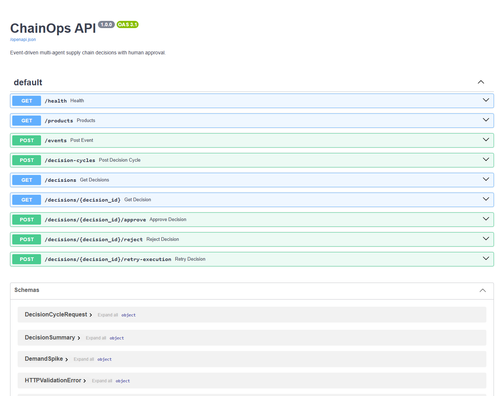

## 10. Scenario simulator (UI)

The Streamlit app has three tabs:

* **Decision cycle**: the original one-click cycle per product, now showing the full record with approve / reject buttons.
* **Scenario simulator**: pick a preset or adjust stock, demand multiplier, shipment delay and open orders. The scenario runs through the real graph as a dry run. A baseline vs scenario table shows exactly what changed.
* **Approvals and audit**: pending queue, all decisions with status filter, and full inspection of any record.

Presets (`src/scenarios.py`) and what they produce with the seed data:

| Scenario | Overlay | Outcome |
|---|---|---|
| Baseline | none | HOLD, no action |
| Low inventory | Widget A stock 250 to 60 | REORDER 140, approval required |
| Sudden demand increase | Widget A demand x3 | REORDER 350, approval required (also over the 300 threshold) |
| Supplier delay | shipment +10 days, supplier reliability 95% to 80% | logistics risk HIGH, but HOLD: stock still covers the reorder point |
| Conflicting signals | stock 120, no open orders | demand and logistics HIGH vs inventory HOLD; coordinator follows inventory, HOLD |
| Data-quality failure | Widget B stock -15 | VALIDATION_FAILED, no agent runs |
| Order ceiling | Widget C demand x8 | order capped at 1000, approval required |

Every number on these screens comes from the recorded decision, not from hard-coded mock screens.

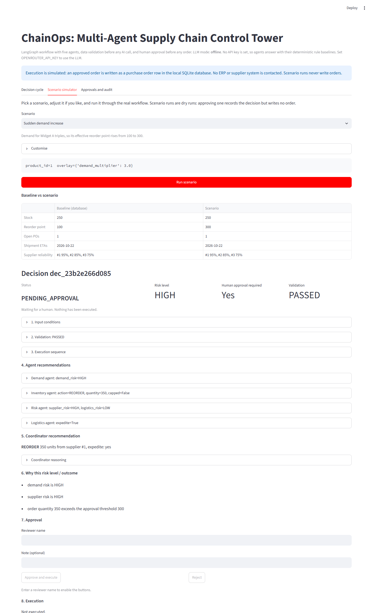

## 11. Evaluation methodology and results

`evals/scenarios.json` holds 18 scenarios. `evals/run_evals.py` runs each through the real workflow on a fresh seeded database and checks it with **deterministic assertions** on structured fields: status, decision type, quantity, risk level, approval routing, specific agent fields, validation error codes, PO counts and governance outcomes.

Coverage:

| Category | Scenarios |
|---|---|
| Baseline / stable demand | S01 |
| Event triggers and thresholds | S02 demand spike, S03 supplier delay on a critical product, S16 below threshold |
| Data validation | S04 negative stock, S05 schema violation, S15 stale event, S17 inconsistent reference |
| Governance | S06 high-risk order over ceiling, S08 approved, S09 rejected (and cannot execute afterwards) |
| Conflicting agent signals | S07 |
| AI-output validation (fault injection) | S10 malformed coordinator output, S12 unsafe LLM answers (LLM says LOW risk and HOLD when rules say HIGH and REORDER) |
| Failure recovery | S11 LLM unavailable for every agent, S14 execution failure then retry |
| Idempotency | S13 duplicate webhook, S18 double approval |

Fault-injection scenarios replace one agent's LLM answer with malformed text, an unsafe answer, or a raised `TimeoutError`.

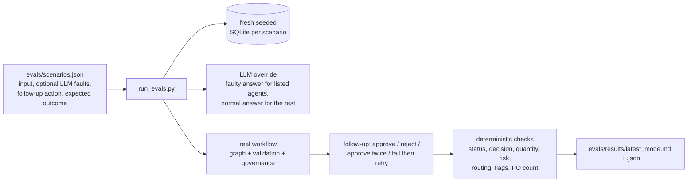

The same scenarios also run as pytest cases (`tests/integration/test_eval_scenarios.py`), so a regression in any of them fails the test suite. Terminal output of the offline run:

```text
PASS  S01  Normal inventory, stable demand
PASS  S02  Demand spike with insufficient inventory
PASS  S03  Supplier delay affecting a critical, low-stock product
PASS  S04  Invalid inventory data (negative stock)
PASS  S05  Malformed event payload (schema)
PASS  S06  High-risk replenishment above the order ceiling
PASS  S07  Conflicting signals (risk HIGH, stock sufficient)
PASS  S08  High-risk recommendation approved by a human
PASS  S09  High-risk recommendation rejected by a human
PASS  S10  Malformed coordinator output
PASS  S11  LLM unavailable for every agent (recovery via rule fallback)
PASS  S12  Unsafe LLM answers cannot bypass approval
PASS  S13  Duplicate event delivery (webhook retry)
PASS  S14  Execution failure, then successful retry
PASS  S15  Stale event
PASS  S16  Event below trigger threshold
PASS  S17  Inconsistent reference (shipment of another product)
PASS  S18  Double approval does not create a second order

18/18 scenarios passed. Report: evals\results\latest_offline.md
```

LLM free text is never compared with exact strings. One explicitly defined text criterion is reported: the coordinator's explanation must mention the actual stock level ("grounded"). There is no LLM-as-judge; it would add non-determinism and is not needed for the properties tested.

**Actual results.** Offline: `python evals/run_evals.py` ([report](evals/results/latest_offline.md)). Live: `python evals/run_evals.py --llm live` with `openai/gpt-4o-mini` through OpenRouter ([report of the last run](evals/results/latest_live.md)). The live suite was run three times, because LLM output varies between runs. Run 1 was before rule 8 of the approval policy existed; its supplier-deviation count was read from the stored decision metadata.

| Metric | Offline | Live (3 runs) |
|---|---|---|
| Scenarios passed | 18/18 | 18/18 in every run |
| Risk classification | 5/5 | 5/5 in every run |
| Decision agreement with expected outcome | 10/10 | 10/10 in every run |
| Human-approval routing | 10/10 | 10/10 in every run |
| Validation enforcement (invalid input stopped before agents) | 4/4 | 4/4 in every run |
| Structured output validity, runs without injected faults | 50/50 | 50/50 in every run |
| LLM answer disagreed with the rule baseline | n/a (rules answer) | 0 in every run |
| Coordinator picked a supplier other than the most reliable | n/a | 1, 2 and 1 of 10 decisions (rule 8 now sends these to a human) |
| Injected faults detected | 3/3 | 3/3 in every run |
| Workflow completion | 17/17 | 17/17 in every run |
| Grounded coordinator explanations (mention actual stock) | 12/13 | 11/13, 10/13, 11/13 |
| Cycle latency p50 / max | 12 ms / 124 ms | about 11 to 12 s / 14 to 16 s |

**What the numbers mean.**

* **Offline** the agents answer with the same rules the expected outcomes are based on, so 100% shows that orchestration, validation, governance and fault handling work. It does not measure the LLM.
* **Live**, gpt-4o-mini followed the format and the classification rules in every un-injected call, so the guard rails never had to correct a classification. The 18/18 is still partly guaranteed by design: when the model is wrong, the rule baseline wins and the case is sent to a human. That is the point of the architecture, so read the live score as "the system stayed safe with a real model", not as "the model is always right".
* **What the live runs found:**
  * The coordinator sometimes chose Fast Shipping Inc (85%) over Reliable Corp (95%), with reasoning that did not justify it. Its prompt allows trade-offs, so this was valid output, but it was only visible in the metadata. It is now rule 8 of the approval policy and is tracked as a metric.
  * Explanations can be incomplete. In one case the risk agent's classification was correct but its reasoning named only one of the two suppliers under 90%. Only the classification is checked automatically; explanation completeness is not.
  * Latency is dominated by five sequential LLM calls (about 2 to 3 s each).
* Grounding misses include S12, whose injected answer is deliberately ungrounded. The remaining misses are explanations that discussed stock without stating the number.

Live mode in the UI, with the model's own reasoning (`Answer source: llm`):

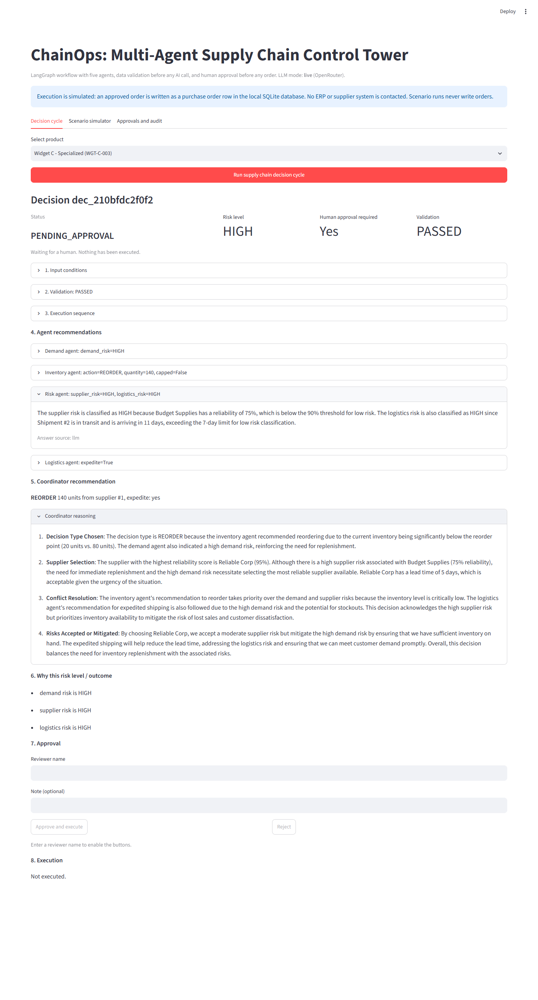

**Tracing.** With `LANGCHAIN_TRACING_V2=true` and a LangSmith key in `.env`, every decision cycle appears in LangSmith as a `LangGraph` run with each agent's LLM call nested inside, tagged with the agent name and its inputs (project `chainops`). This was checked during the live runs.

## 12. Installation and configuration

Requires Python 3.12+ (developed and tested on 3.13, Windows 11).

```bash
git clone https://github.com/amanjaiswal-07/ChainOps.git
```

```bash
cd ChainOps
python -m venv .venv
```

```bash
.venv\Scripts\activate
```

(macOS / Linux: `source .venv/bin/activate`)

```bash
pip install -r requirements.txt
```

```bash
copy .env.example .env
```

The database (`data/supply_chain.db`) is created and seeded automatically on first run. To reset the demo, delete that file.

Key environment variables (all listed in `.env.example`):

| Variable | Default | Meaning |
|---|---|---|
| `LLM_MODE` | `auto` | `auto`: live if a key is set, else offline. `live`: require the LLM. `offline`: rule baselines only |
| `OPENROUTER_API_KEY` | empty | key for OpenRouter |
| `OPENROUTER_MODEL` | `openai/gpt-4o-mini` | model id |
| `LLM_TIMEOUT_SECONDS`, `LLM_MAX_RETRIES` | 30, 2 | per-call timeout and bounded retries (safe: LLM calls have no side effects) |
| `DATABASE_URL` | `data/supply_chain.db` in the repo | SQLAlchemy URL |
| `SUPPLIER_RELIABILITY_THRESHOLD`, `LOGISTICS_MAX_ETA_DAYS` | 0.90, 7 | agent rules |
| `DEMAND_SPIKE_THRESHOLD`, `SHIPMENT_DELAY_THRESHOLD_DAYS` | 1.25, 2 | event triggers |
| `MAX_ORDER_QUANTITY`, `APPROVAL_QUANTITY_THRESHOLD` | 1000, 300 | governance |
| `STALE_PO_DAYS`, `EVENT_MAX_AGE_HOURS` | 30, 24 | validation |

## 13. Running it

**API**

```bash
uvicorn api:app --app-dir src --port 8000
```

**Streamlit UI**

```bash
streamlit run ui/app.py
```

**Automated triggering demo** (API must be running)

```bash
python scripts/event_simulator.py webhook --api http://localhost:8000
```

```bash
python scripts/event_simulator.py scan --interval 60
```

**CLI** (one recorded cycle per product, as in the original project)

```bash
python -m src.main
```

### Five-minute demo walkthrough

1. Start the API and the UI (two terminals, commands above).
2. Run the webhook simulator. Nine events arrive: some start cycles, one is a replay, two are below threshold, three are rejected by the two validation layers.
3. Open the UI, tab **Approvals and audit**. The decisions created by those events are listed, with the pending ones at the top.
4. Inspect a pending decision: input, validation, agent sequence with timings, each agent's reasoning, and the policy rules that made it HIGH risk.
5. Enter a reviewer name and approve. The status becomes `EXECUTED` and the simulated purchase order id appears. Try approving again through the API: `409`.
6. Tab **Scenario simulator**: run *Data-quality failure* (the cycle stops before any agent) and *Sudden demand increase* (order above the approval threshold), and compare baseline vs scenario.
7. Run `pytest` and `python evals/run_evals.py` to show the same behaviour is checked automatically.

## 14. Tests

```bash
pytest
```

143 tests, no API key or network needed: 86 unit tests (`tests/unit`: event schemas, business rules, overlays, output parsers, rule baselines, approval policy, state machine including a concurrency test) and 57 integration tests (`tests/integration`: full graph runs with mocked LLM answers, the event pipeline, every API endpoint through FastAPI's TestClient, and all 18 evaluation scenarios).

Tests that call the real LLM are marked `live` and excluded by default:

```bash
pytest -m live
```

They skip themselves if `OPENROUTER_API_KEY` is not set, and they assert only structure and safety properties, never wording. Both passed against `openai/gpt-4o-mini` (2 tests, about 34 s).

## 15. What is simulated and what is real

| Real | Simulated or assumed |
|---|---|
| LangGraph orchestration, all five agents, LLM calls in live mode | Purchase orders: a row in local SQLite, no ERP or supplier contact |
| Validation, approval policy, state machine, transactions, idempotency | Events: produced by `scripts/event_simulator.py`, not real WMS / carrier systems |
| FastAPI endpoints, audit records, structured logs | Demand spikes: modelled as a scaled reorder point (no demand history in the data) |
| Offline mode: deterministic rule answers, labelled `offline` in every record | Scenario runs: dry runs that record a decision but never write a PO |

## 16. Known limitations

* **Original business rules kept as they were** (details in [`docs/AUDIT.md`](docs/AUDIT.md)):
  * every REORDER is HIGH risk, because the demand rule flags HIGH exactly when stock is below the reorder point. So no order is auto-approved with these rules; the auto-approval path is exercised in unit tests.
  * open purchase orders are not counted as stock, so re-running after an approved order recommends ordering again.
  * supplier risk is HIGH if *any* supplier is under 90%, even one that is not selected.
* **No authentication.** The reviewer name is recorded but not verified.
* **Live evaluation covers one model** (`openai/gpt-4o-mini`) over three runs of 18 scenarios. That is small and model-specific; other models may behave differently.
* **Explanation quality is not scored.** Only structured fields and one grounding criterion are checked; an LLM explanation can be correct but incomplete.
* **Synchronous processing.** Each request runs its cycle inline; a slow LLM means a slow request. Fine for one-product cycles, not for bulk loads.
* **SQLite.** Good for a local prototype; concurrent writers serialize.
* **Approval does not re-check freshness.** A decision approved days later executes on the data it was made with.

## 17. Future improvements

* Inventory position (on hand + on order) in the inventory rule, so open orders are counted.
* Per-supplier risk instead of global supplier risk, so a reliable chosen supplier is not penalised for an unreliable unused one.
* Re-validate the snapshot at approval time and expire stale pending decisions.
* Reviewer authentication and role-based approval limits (for example, larger orders need a manager).
* Run the live evaluation regularly and track LLM vs rule disagreement rates across model versions.
* Move cycles to a background worker if event volume grows beyond what synchronous requests handle.

## 18. Project structure

```
src/
  api.py                 FastAPI app
  workflow.py            runs cycles and the event pipeline, records results
  governance.py          decision records, approval state machine, execution
  graph.py               LangGraph graph
  state.py               shared graph state
  events.py              event schemas, event rules, trigger thresholds
  overlay.py             what-if snapshot overlays (events and scenarios)
  validation.py          business-rule validation
  config.py              all thresholds and settings
  llm_config.py          LLM client, offline mode, test hook
  logging_config.py      JSON logs
  scenarios.py           simulator presets
  models.py, db_service.py, db_init.py   database
  backend_interface.py   UI entry point (kept from the original)
  main.py                CLI (kept from the original)
  agents/                demand, inventory, risk, logistics, coordinator,
                         rules.py (deterministic baselines), outputs.py (AI-output validation)
  nodes/                 data_ingestion, data_validation, decision_gate, human_approval
ui/app.py                Streamlit UI
scripts/event_simulator.py   webhook sender and scheduled scanner
evals/                   scenarios.json, run_evals.py, results/
tests/                   unit/, integration/, live/
docs/                    AUDIT.md (baseline audit), SUMMARY.md (deliverables), screenshots/
```

## Author

**Aman Jaiswal**

* GitHub: [github.com/amanjaiswal-07](https://github.com/amanjaiswal-07)
* LinkedIn: [linkedin.com/in/aman-jaiswal-aa31b51b5](https://www.linkedin.com/in/aman-jaiswal-aa31b51b5)
